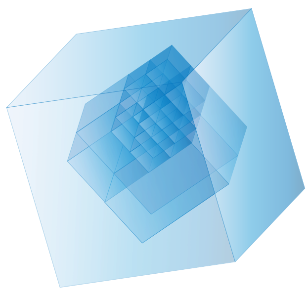

<!-- ============ Hero ============ -->

Open Source &middot; Developed at Fraunhofer AISEC

# Minimal and Secure OS&#8209;level Virtualization

GyroidOS is a multi-arch OS-level virtualization solution with a strong focus on
platform security based on hardware features. Built with Linux and Yocto, it isolates
guest operating systems in containers on a single, hardened kernel — with a far
smaller footprint than conventional container stacks.

[Get Started](#get-started-in-three-steps){ .md-button .md-button--primary }
[View on GitHub](https://github.com/gyroidos){ .md-button }

<svg viewBox="0 0 340 300" class="gy-diagram" aria-label="GyroidOS architecture stack">
  <g text-anchor="middle">
    <rect x="20"  y="20" width="90" height="70" rx="8" class="gyd-container"/>
    <text x="65" y="50" class="gyd-label">Service</text>
    <text x="65" y="70" class="gyd-sublabel">Container</text>
    <rect x="125" y="20" width="90" height="70" rx="8" class="gyd-container"/>
    <text x="170" y="50" class="gyd-label">Service</text>
    <text x="170" y="70" class="gyd-sublabel">Container</text>
    <rect x="230" y="20" width="90" height="70" rx="8" class="gyd-core"/>
    <text x="275" y="50" class="gyd-label">Core</text>
    <text x="275" y="70" class="gyd-sublabel">unprivileged</text>
    <rect x="20" y="105" width="300" height="50" rx="8" class="gyd-cml"/>
    <text x="170" y="135" class="gyd-label">Container Management Layer (CML)</text>
    <rect x="20" y="170" width="300" height="50" rx="8" class="gyd-kernel"/>
    <text x="170" y="195" class="gyd-label">Hardened Linux Kernel</text>
    <text x="170" y="213" class="gyd-sublabel">namespaces &middot; cgroups &middot; capabilities</text>
    <rect x="20" y="235" width="300" height="50" rx="8" class="gyd-hw"/>
    <text x="170" y="260" class="gyd-label">Hardware</text>
    <text x="170" y="278" class="gyd-sublabel">TPM &middot; Secure Boot &middot; x86 / ARM / RISC-V</text>
  </g>
</svg>

__Multi-arch__ x86 &middot; ARM &middot; RISC&#8209;V

__Hardware-backed__ TPM, secure &amp; measured boot

__Minimal TCB__ Small, auditable codebase

__Fully open source__ GPL-2.0 licensed

<a class="gy-scroll-hint" href="#what-is-gyroidos" aria-label="Scroll down">
<svg viewBox="0 0 24 24" width="28" height="28" aria-hidden="true"><path d="M7.41 8.58 12 13.17l4.59-4.59L18 10l-6 6-6-6z" fill="currentColor"/></svg>
</a>

## What is GyroidOS?

GyroidOS is a virtualization platform on the operating-system level, developed and
maintained at [Fraunhofer AISEC](https://www.aisec.fraunhofer.de/en/fields-of-expertise/SOS.html).
Its virtualization layer builds on Linux kernel features — namespaces, cgroups and
capabilities — to isolate complete guest operating system stacks on top of a single,
shared kernel.

In contrast to general-purpose container solutions such as Docker, GyroidOS provides
a much smaller footprint, strict separation of privileged components, and integrates
platform-specific hardware security mechanisms directly into the virtualization layer.
Even the core container, which contains administration interfaces, is already
unprivileged and accesses the CML only through its control interface. Each container is
strongly isolated, so applications with different trust levels can run side by side
on the same device without compromising one another.

The project has been developed since the early 2010s (formerly known as *trust|me*)
and serves as the reference implementation of the Trusted Connector in the
International Data Spaces (IDS).

!!! info "Typical use cases"

    - :material-check:{ .gy-check } **Application separation** — run untrusted and
      critical workloads in parallel with a clearly defined level of isolation.
    - :material-check:{ .gy-check } **IoT & edge devices** — a secure, remotely
      manageable platform for embedded devices in the field.
    - :material-check:{ .gy-check } **Certifiable systems** — a baseline that supports
      security certification processes such as Common Criteria (ISO/IEC 15408),
      IEC 62443 and DIN SPEC 27070.
    - :material-check:{ .gy-check } **Trusted data exchange** — reference
      implementation of the IDS Trusted Connector.

## Architecture

A minimal, privileged Container Management Layer controls strongly isolated guest
containers — anchored in hardware security features from the very first boot stage.
{ .gy-lead }

-   :material-layers-outline:{ .lg .middle } __Container Management Layer__

    ---

    The heart of GyroidOS is the [CML](https://github.com/gyroidos/cml), a set of
    lean daemons written in C that manage the container lifecycle. Privileged
    functionality is kept out of guest containers, shrinking the attack surface
    and the trusted computing base.

-   :material-shield-check-outline:{ .lg .middle } __Secure & measured boot__

    ---

    A complete chain of trust — from bootloader through kernel and signed kernel
    modules to containers — can be verified via
    [secure boot](https://gyroidos.github.io/architecture/secure_boot/) and recorded via
    [measured boot](https://gyroidos.github.io/architecture/measured_boot/) with
    TPM-based remote attestation.

-   :material-harddisk:{ .lg .middle } __Encrypted storage__

    ---

    Container data volumes are protected with
    [storage encryption](https://gyroidos.github.io/architecture/storage_encryption/),
    with keys bound to the platform's hardware trust anchor.

-   :material-certificate-outline:{ .lg .middle } __PKI & remote management__

    ---

    A project-owned [PKI](https://gyroidos.github.io/pki/) underpins signed guest OS
    images, device provisioning and flexible
    [remote management](https://gyroidos.github.io/operate/control/) of containers
    in the field.

## Key Features

-   :material-cube-outline:{ .lg .middle } __Minimal footprint__

    ---

    A deliberately small software stack built with Yocto — less code, fewer
    vulnerabilities, easier audits.

-   :material-shield-lock-outline:{ .lg .middle } __Hardware-backed security__

    ---

    TPM integration, secure boot, measured boot and kernel module signing are
    built into the platform, not bolted on.

-   :material-wall:{ .lg .middle } __Strong isolation__

    ---

    Guest OS stacks are confined via namespaces, cgroups and capabilities, with a
    reduced syscall surface toward the shared kernel.

-   :material-chip:{ .lg .middle } __Multi-architecture__

    ---

    One platform for x86, 32/64-bit ARM and RISC-V — from developer VMs in QEMU
    to embedded boards in production.

-   :material-clipboard-check-outline:{ .lg .middle } __Certification support__

    ---

    Designed to ease security certification: Common Criteria (ISO/IEC 15408),
    IEC 62443 and DIN SPEC 27070 profiles.

-   :material-open-source-initiative:{ .lg .middle } __Fully open source__

    ---

    The complete, portable software stack is developed in the open on GitHub
    under GPL-2.0, including a converter for Docker containers.

## Supported Platforms

GyroidOS runs on generic hardware of all major architectures. Ready-to-follow
deployment guides exist for:
{ .gy-lead }

-   __Generic x86 hardware__

    UEFI secure boot &middot; TPM 2.0

    [:octicons-arrow-right-24: x86 guide](https://gyroidos.github.io/deploy/x86/)

-   __Raspberry Pi__

    32- and 64-bit deployment guides

    [:octicons-arrow-right-24: Raspberry Pi guide](https://gyroidos.github.io/deploy/rpi/)

-   __NXP i.MX8 (TQMa8MPxL)__

    Industrial-grade module with HAB secure boot

    [:octicons-arrow-right-24: i.MX8 guide](https://gyroidos.github.io/deploy/tqma8mpxl/)

-   __BeagleV-Fire (RISC-V)__

    PolarFire SoC FPGA board

    [:octicons-arrow-right-24: BeagleV-Fire guide](https://gyroidos.github.io/deploy/beaglev-fire/)

-   __QEMU / KVM__

    Try GyroidOS without dedicated hardware

    [:octicons-arrow-right-24: QEMU guide](https://gyroidos.github.io/deploy/qemu/)

-   __Hosted mode__

    Run the CML on an existing Linux distribution

    [:octicons-arrow-right-24: Hosted mode guide](https://gyroidos.github.io/deploy/hosted/)

## Get Started in Three Steps

-   :material-numeric-1-circle:{ .lg .middle } __Set up your host__

    ---

    Prepare your build machine with the required tools for Yocto-based builds.

    [:octicons-arrow-right-24: Host setup](https://gyroidos.github.io/build/setup_host/)

-   :material-numeric-2-circle:{ .lg .middle } __Build an image__

    ---

    Use the quick-build workflow to create a complete GyroidOS image for your target.

    [:octicons-arrow-right-24: Quick build](https://gyroidos.github.io/build/quickbuild/)

-   :material-numeric-3-circle:{ .lg .middle } __Deploy & operate__

    ---

    Boot the image in QEMU or on real hardware and manage containers with the
    control interface.

    [:octicons-arrow-right-24: Deploy to QEMU](https://gyroidos.github.io/deploy/qemu/)

## Resources

-   :material-book-open-variant:{ .lg .middle } __Documentation__

    ---

    Architecture, build, deployment and operation guides.

    [:octicons-arrow-right-24: Read the docs](https://gyroidos.github.io/)

-   :material-github:{ .lg .middle } __Source code__

    ---

    All repositories — CML, build system and Yocto layers — on GitHub.

    [:octicons-arrow-right-24: github.com/gyroidos](https://github.com/gyroidos)

-   :material-file-certificate-outline:{ .lg .middle } __Certification__

    ---

    How GyroidOS supports Common Criteria and IEC 62443 processes.

    [:octicons-arrow-right-24: Certification](https://gyroidos.github.io/certification/)

-   :material-presentation:{ .lg .middle } __Talks & publications__

    ---

    Conference talks and academic research behind the platform.

    [:octicons-arrow-right-24: Talks & publications](publications.md)

Questions, feedback or interest in collaboration?

[Contact the team](mailto:gyroidos@aisec.fraunhofer.de){ .md-button .md-button--primary }

